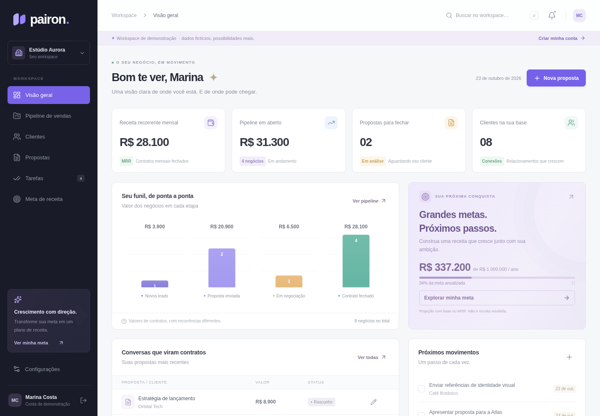

# Pairon

SaaS para agências e consultorias organizarem clientes, oportunidades, propostas comerciais e próximos contatos. O repositório contém uma aplicação funcional com frontend React e API Express, autenticação por sessão e SQLite persistente.



## Baixar e usar no seu computador

Baixe o ZIP desta branch pelo GitHub, extraia todos os arquivos e instale **Node.js 24.4 ou superior**. Abra o terminal dentro da pasta extraída e execute:

```bash
npm ci
npm run build
npm start
```

No navegador desse mesmo computador, digite `localhost:3001` na barra de endereços. Clique em **Explorar demonstração** ou crie sua própria conta. O aplicativo ainda não tem endereço público na internet; a imagem acima é uma prévia visual.

Se recebeu o pacote `Pairon.zip` preparado para download, ele também inclui `VISUALIZAR.html`, que abre uma prévia estática sem instalação, e `dist`, com a interface já compilada. Nesse pacote, `npm ci --omit=dev` e `npm start` bastam para executar o aplicativo.

## Executar no ambiente de desenvolvimento

Requer **Node.js 24.4 ou superior**, npm e acesso a `registry.npmjs.org`. Não exige chave de API ou serviço externo para o fluxo principal.

```bash
cd /workspace/SaaSpairon
npm ci --cache /workspace/.cache/npm
npm run dev
```

O frontend usa a porta 5173 e encaminha `/api` para a API na porta 3001. Abra a aplicação pelo mecanismo de acesso da sua hospedagem. A página inicial permite criar uma conta vazia ou explorar uma demonstração isolada com dados fictícios. Nenhuma senha de demonstração é compartilhada.

```bash
# Compilação e execução da aplicação em um único processo
npm run build
npm start
```

Após a compilação, a API também entrega o frontend na porta 3001. `GET /api/health` confirma a resposta do serviço; os testes abaixo verificam o comportamento funcional.

## O que funciona

- Cadastro, entrada e saída com senhas protegidas por scrypt e cookies de sessão HttpOnly.
- Dados separados por conta, com clientes, oportunidades e etapas do funil.
- Propostas com serviços, quantidade, preço, validade e link público.
- Aceite comercial pelo cliente, que registra nome/data e marca a oportunidade vinculada como ganha.
- Tarefas e metas de receita, com distinção entre contratos recorrentes e projetos pontuais.
- Demonstração identificada, separada das contas reais e das outras sessões de demonstração.

O link público de uma proposta permite visualizar seu escopo e registrar o aceite. Compartilhe-o somente com o destinatário pretendido. Rascunhos são privados, propostas vencidas não podem ser aceitas e o aceite comercial não é assinatura digital certificada.

## Dados e operação

O banco padrão é `.data/pairon.sqlite`, fora do versionamento. Defina `DB_PATH` para um arquivo em um volume persistente e `PORT` para mudar a porta da API. Os arquivos SQLite `-wal` e `-shm` fazem parte do estado enquanto o processo está ativo. Preserve o banco entre reinícios; uma implantação com disco efêmero perderá os dados.

Para um backup simples consistente, pare o processo de escrita, copie o diretório `.data` para um destino protegido e reinicie o serviço. Para restaurar, pare o serviço e restaure esse diretório antes de iniciar novamente. Não adicione bancos, senhas ou backups ao Git. Em produção, teste restauração e automatize backups antes de receber dados reais.

O MVP usa uma conta por espaço de trabalho. Convites de equipe, recuperação de senha por e-mail, cobrança automática, checkout, emissão fiscal e conciliação financeira ainda não fazem parte do produto. Valores recorrentes representam contratos registrados, não pagamentos confirmados.

## Validação

```bash
npm test           # Integração HTTP real, contas isoladas e persistência em banco temporário
npm run build      # TypeScript e pacote de produção
npm run test:e2e   # Fluxo real no Chromium; executar após o build
```

Os testes de navegador usam `/usr/bin/chromium` quando disponível, ou `CHROMIUM_PATH`. Em outra máquina, também é possível instalar o navegador do Playwright com `npx playwright install chromium`. Eles iniciam seu próprio servidor na porta 3101 com um banco temporário, sem alterar o banco de desenvolvimento.

## Implantação

Há um Dockerfile para empacotar o aplicativo. Os comandos de implantação são fornecidos para execução no destino escolhido; criar a imagem não publica o serviço.

Neste ambiente, a compilação e execução por Node foram validadas. O build Docker não foi concluído: a busca de pacotes dentro do BuildKit falhou com erro de DNS `EAI_AGAIN`, mesmo com proxy e CA configurados. Portanto, o contêiner ainda precisa ser validado no destino de implantação. O Dockerfile aceita uma CA adicional pelo segredo opcional de build `package_ca`, sem desabilitar TLS.

```bash
docker build -t pairon .
docker volume create pairon-data
docker run --rm --name pairon -p 3001:3001 -v pairon-data:/app/.data pairon
```

Antes de disponibilizar publicamente, configure HTTPS e o domínio na hospedagem, persistência e backups. Atrás de um proxy reverso confiável que termina o HTTPS, use `TRUST_PROXY=1` para reconhecer o protocolo e aplicar cookies Secure, e `APP_ORIGIN=https://seu-dominio` para explicitar a origem pública. Só habilite a confiança no proxy quando a conexão direta estiver protegida pelo proxy da hospedagem. Mantenha uma única instância de escrita para este banco SQLite; múltiplas réplicas exigem uma arquitetura de dados diferente. Uma implantação pública deve ser verificada no destino real.

## Meta comercial

R$ 1 milhão por ano é uma meta de negócio, sem garantia de resultado. Como cenário, **168 clientes a R$ 497/mês = R$ 1.001.952 de receita bruta anualizada**, antes de cancelamentos, taxas, impostos e custos. Receita anualizada não equivale ao faturamento acumulado no ano.

O [plano comercial](docs/PLANO-COMERCIAL.md) descreve o público, a oferta, entrevistas, pilotos e o lançamento do MVP até domingo, 25/10/2026. Os preços são hipóteses a validar; não há assinaturas sendo cobradas neste aplicativo.
